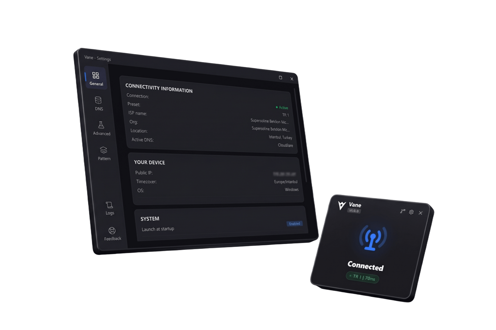

<p align="center">
  
</p>

<h1 align="center">Vane DPI</h1>

<p align="center">
  <strong>Продвинутый центр обхода DPI и зашифрованного DNS (на базе Zapret)</strong>
</p>

<p align="center">
  <a href="../../README.md"></a>
  <a href="README.tr.md"></a>
  <a href="README.zh.md"></a>
  <a href="README.fa.md"></a>
</p>

<p align="center">
  <a href="https://archey.com.tr"></a>
  
  
  
  <a href="https://discord.com/users/852103749228036136"></a>
</p>

<p align="center">
  
</p>

---

## Содержание

- [1. Что такое Vane?](#1-что-такое-vane)
  - [Что автоматизирует Vane](#что-автоматизирует-vane)
- [2. Ключевые возможности](#2-ключевые-возможности)
  - [2.1. DNS Guard: локальный зашифрованный резолвер](#21-dns-guard-локальный-зашифрованный-резолвер)
  - [2.2. Блокировка рекламы и телеметрии (AdBlock)](#22-блокировка-рекламы-и-телеметрии-adblock)
  - [2.3. Dual-Stack DNS Kill Switch](#23-dual-stack-dns-kill-switch)
  - [2.4. Сторожевой таймер (Watchdog)](#24-сторожевой-таймер-watchdog)
  - [2.5. Оптимизатор пресетов](#25-оптимизатор-пресетов)
  - [2.6. SOCKS5 Upstream Прокси](#26-socks5-upstream-прокси)
  - [2.7. Синхронизация пресетов](#27-синхронизация-пресетов)
  - [2.8. Консоль с тегами логов](#28-консоль-с-тегами-логов)
  - [2.9. Автозагрузка с учетом ОС](#29-автозагрузка-с-учетом-ос)
  - [2.10. Отслеживание смены сети](#210-отслеживание-смены-сети)
- [3. Безопасность и архитектура](#3-безопасность-и-архитектура)
- [4. Встроенные пресеты](#4-встроенные-пресеты)
- [5. Архитектура файрвола (Linux и Windows)](#5-архитектура-файрвола-linux-и-windows)
- [6. Установка и сборка из исходников](#6-установка-и-сборка-из-исходников)
- [7. Устранение неполадок, лицензия и авторы](#7-устранение-неполадок-лицензия-и-авторы)

---

## 1. Что такое Vane?

Vane — это графическое десктопное приложение с открытым исходным кодом для управления популярным движком обхода DPI [zapret](https://github.com/bol-van/zapret). Оно объединяет низкоуровневые службы `winws` (Windows) и `nfqws` (Linux) в элегантный, легковесный интерфейс, созданный на базе Tauri v2, Rust, React 19 и Zustand.

**Vane — это НЕ VPN.** Программа не перенаправляет ваш трафик через сторонние удаленные серверы. Она работает локально на вашем компьютере, модифицируя пакеты рукопожатия TCP/TLS и UDP на лету. Это сбивает с толку оборудование ТСПУ / DPI интернет-провайдеров, восстанавливая доступ к заблокированным сервисам (YouTube, Discord и др.) с сохранением полной скорости и родного пинга вашего интернет-канала.

### Что автоматизирует Vane

| Задача | Ручная настройка Zapret | С помощью Vane |
|---|---|---|
| **Целостность бинарников** | Локальные непроверенные файлы | Minisign + SHA-256 + проверка TOCTOU перед запуском |
| **Запуск движка** | Длинные консольные команды с 20+ флагами | Запуск в один клик с визуальным контролем |
| **Шифрование DNS** | Ручная правка stub-резолверов ОС | Встроенный DoH/DoT резолвер с транзакционным откатом |
| **Защита от утечек DNS** | Внешние утилиты / частые утечки | Dual-Stack (IPv4 + IPv6) Kill Switch |
| **Настройка файрвола** | Ручные команды iptables / установка драйверов | Автоматические правила nftables / iptables / WinDivert |
| **Очистка при сбоях** | Зависшие правила и сломанный интернет | Windows Job Object + восстановление фильтров Linux |
| **Управление пресетами** | Ручное редактирование .cmd / bash скриптов | Визуальный редактор, пакеты `.vane`, автосинхронизация |
| **Диагностика сети** | Ручной ping, curl и traceroute | Тест связности в один клик и анонимизированные баг-репорты |

---

## 2. Ключевые возможности

### 2.1. DNS Guard: локальный зашифрованный резолвер

DNS Guard запускает локальный резолвер на `127.0.0.127:5353`. Он перехватывает открытые запросы UDP/53 от системы и приложений, отправляя их по защищенным каналам:
- **Cloudflare** (DoH / DoT): `https://cloudflare-dns.com/dns-query`
- **Google** (DoH / DoT): `https://dns.google/dns-query`
- Встроенный кэш с соблюдением TTL, поддержка локальных зон (`.local`, `.lan`) и автоматический откат при ошибках (`DnsTransactionManager`).

### 2.2. Блокировка рекламы и телеметрии (AdBlock)

DNS Guard содержит встроенный список [StevenBlack hosts](https://github.com/StevenBlack/hosts) с более чем 100 000 доменов рекламы, фишинга и телеметрии. Запросы к ним немедленно блокируются ответом `0.0.0.0` без обращения в сеть.

### 2.3. Dual-Stack DNS Kill Switch

- **Windows:** Блокирует открытый порт 53 через `netsh advfirewall` для всех внешних адресов IPv4 и IPv6, оставляя доступным только локальный loopback (`127.0.0.1` и `::1`).
- **Linux:** Изолирует цепочку `OUTPUT` в `iptables` и `ip6tables`, исключая утечки незашифрованных запросов.

### 2.4. Сторожевой таймер (Watchdog)

Фоновый процесс непрерывно проверяет доступность ключевых сервисов (например, `discord.com`). В случае сбоя или блокировки параметров сторож перезапускает службу или предлагает протестировать другие пресеты.

### 2.5. Оптимизатор пресетов

Автоматически тестирует доступные пресеты вашей библиотеки на реальных сетевых целях, определяя конфигурацию с наилучшей скоростью и стабильностью.

### 2.6. SOCKS5 Upstream Прокси

Если ваш провайдер блокирует сами адреса DoH (Cloudflare / Google), запросы DNS Guard могут маршрутизироваться через надежный SOCKS5 прокси.

### 2.7. Синхронизация пресетов

Возможность подключения удаленных Gist-репозиториев с проверенными конфигурациями. Обновления проверяются цифровой подписью Minisign.

### 2.8. Консоль с тегами логов

Удобная визуализация потока событий: `[MOTOR]`, `[DNS]`, `[ADBLOCK]`, `[GÜVENLİK]`, `[SİSTEM]`, `[HATA]`.

---

## 3. Безопасность и архитектура

```
+--------------------------------------------------------------------------+
|                             Архитектура Vane                             |
+--------------------------------------------------------------------------+
|  [ Web UI: React 19 + Zustand ]                                          |
|         |                                                                |
|  [ Мост Tauri IPC ] -- (Строгий CSP, Белый список путей и SSRF)          |
|         |                                                                |
|  [ Ядро Rust: EngineManager, DnsTransactionManager, DiagnosticsStore ]   |
|         |                                                                |
|   +-----+--------------------------------+                               |
|   | (Windows)                            | (Linux)                       |
|   v                                      v                               |
| [ Драйвер WinDivert64.sys ]        [ Движок nftables / iptables ]        |
| [ Процесс winws.exe ]              [ Процесс nfqws (Изолированный setcap)|
| [ Windows Job Object (Auto-Kill) ] [ Модуль очистки зависших правил ]    |
+--------------------------------------------------------------------------+
```

- **Изоляция привилегий Linux:** Флаги `cap_net_admin,cap_net_raw+ep` выдаются **только** бинарнику `nfqws`. Основное приложение работает полностью без root-прав, предотвращая падение песочницы WebKitGTK.
- **Защита от подмены (TOCTOU):** Проверка SHA-256 выполняется непосредственно в момент вызова исполняемых файлов.

---

## 4. Встроенные пресеты

| ID | Название | Протоколы | Стратегия обхода | Назначение |
|---|---|---|---|---|
| `tr-1` | **TR Standard** | TCP 80, 443 | `fake,multidisorder` + `autottl` + `badseq` | Веб-сайты, медиа, соцсети |
| `tr-2` | **TR Aggressive** | TCP 80, 443 | `fake,multidisorder` + `md5sig` + fixed TTL | Провайдеры со строгим TCP-анализом |
| `tr-3` | **TR Fragment** | TCP 80, 443 | `multisplit` + `fakedsplit` | Жесткая фильтрация TLS |
| `tr-4` | **TR Desync-HTTPS**| TCP 443 | Разделение SNI | Фильтрация только по HTTPS |
| `tr-5` | **TR QUIC** | UDP 443 | `fakeknown` + `udplen` | YouTube 4K (QUIC / HTTP3) |
| `discord-voip` | **Discord & VoIP** | UDP 50000-65535 | UDP Fake Packet Injection | Голосовые каналы Discord и онлайн-игры |

> [!TIP]
> Полное техническое описание параметров Zapret и режимов сбивания DPI (`badseq`, `badsum`, `md5sig`) смотрите в руководстве [DPI and Zapret Internals Guide](../DPI_AND_ZAPRET_INTERNALS.md).

---

## 5. Архитектура файрвола (Linux и Windows)

- **Windows:** Управление `winws.exe` через подписанный драйвер `WinDivert64.sys`. Связка с Windows Job Object гарантирует моментальное завершение службы и снятие фильтров при закрытии приложения.
- **Linux:** Приоритетный бэкенд `nftables` (ядро 5.x+) с транзакционными правилами и пропуском локального интерфейса (`oifname "lo" return`), с автоматическим откатом на `iptables` в устаревших системах.

---

## 6. Установка и сборка из исходников

### 6.1. Системные требования

| Платформа | Минимальная версия ОС | Зависимости | Права доступа |
|---|---|---|---|
| **Windows** | Windows 10 (1809+) или Windows 11 | Не требуются (драйвер WinDivert встроен) | Администратор (UAC) |
| **Linux** | Ubuntu 22.04+, Debian 12+, Fedora 38+, Arch | `libwebkit2gtk-4.1`, `nftables` или `iptables` | Обычный пользователь (`pkexec` для nfqws) |

### 6.2. Готовые пакеты установки

Готовые бинарные файлы доступны на странице [GitHub Releases](https://github.com/lulushuz/Vane/releases):
- **Windows:** Скачайте `Vane_0.2.0_x64-setup.exe` или `.msi`.
- **Linux:** Скачайте `vane_0.2.0_amd64.deb` или портативный `.AppImage`:

```bash
# Установка Debian / Ubuntu:
sudo dpkg -i vane_0.2.0_amd64.deb

# Запуск AppImage:
chmod +x Vane_0.2.0_amd64.AppImage
./Vane_0.2.0_amd64.AppImage
```

### 6.3. Сборка из исходного кода

```bash
git clone https://github.com/lulushuz/Vane.git
cd Vane
npm install
npm run tauri dev
```

---

## 7. Устранение неполадок, лицензия и авторы

### 7.1. Устранение неполадок

| Проблема | Причина | Решение |
|---|---|---|
| **Движок не стартует на Windows** | Конфликт с другими службами WinDivert | Закройте GoodbyeDPI или аналогичные утилиты |
| **Не работает DNS** | Провайдер блокирует IP-адреса DoH | Включите SOCKS5 upstream proxy в настройках DNS |
| **Ошибка песочницы на Linux** | Привилегии выданы главному бинарнику | Убедитесь, что `setcap` применен только к `nfqws` |
| **Зависает подключение к голосовому каналу Discord** | Блокируются диапазоны UDP | Выберите пресет `discord-voip` |

### 7.2. Лицензия и благодарности

- **[zapret](https://github.com/bol-van/zapret)** (bol-van): Ядро модификации пакетов (`winws` и `nfqws`).
- **[WinDivert](https://reqrypt.org/windivert.html)** (basil00): Драйвер перехвата пакетов в пользовательском режиме для Windows.
- **[Tauri](https://tauri.app)**: Фреймворк для настольных приложений.
- **[StevenBlack/hosts](https://github.com/StevenBlack/hosts)**: База хостов блокировки рекламы.

Проект распространяется под лицензией **GNU General Public License v3.0** (`GPL-3.0`). Подробности в файле [LICENSE](../../LICENSE).

- **Связь в Discord:** [lulushu (Discord ID: 852103749228036136)](https://discord.com/users/852103749228036136)
- **Баг-трекер:** [GitHub Issues](https://github.com/lulushuz/Vane/issues)
